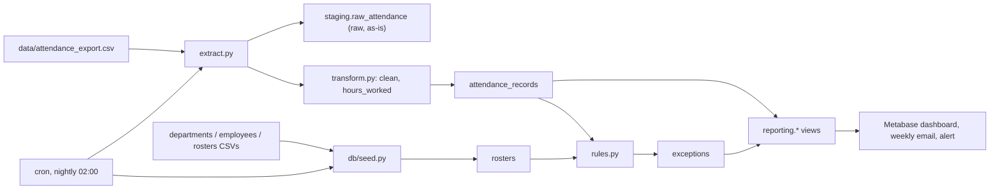

# SecureLock Global - Time and Attendance Reporting System

This system ingests timeclock exports, cleans them, and flags attendance
exceptions automatically. It serves the results in a Metabase dashboard,
with a weekly emailed report and an alert for open exceptions.

**Stack:** PostgreSQL 16, Python 3.12 (pandas and SQLAlchemy 2), Metabase, cron, and Docker Compose.

---

## Architecture



| Service    | What it does                                                                 | Port |
|------------|-------------------------------------------------------------------------------|------|
| `postgres` | Runs the init scripts in `db/` on first start (schema, views, read-only role). | 5432 |
| `etl`      | Generates sample data if `/data` is empty, seeds reference data, and runs the ETL once at start. After that, cron runs it nightly. | none |
| `metabase` | The BI dashboard. Its own app data lives in a separate `metabase` database.     | 3000 |
| `mailpit`  | *Optional* (`--profile mail`): a local SMTP sink for testing emails.           | 8025 |

### Repository layout

```text
db/        schema.sql, reporting_views.sql, init_databases.sh, generate_sample_data.py, seed.py
etl/       config, db, extract, transform, load, rules, run_etl (CLI), entrypoint.sh, crontab.template
docker/    etl.Dockerfile
data/      sample CSVs (departments, employees, rosters, attendance_export)
docs/      this README, metabase_setup.md, metabase_queries.sql
tests/     pytest suite for the exception rules and cleaning steps
```

---

## Quick start

Prerequisites: Docker Desktop or Docker Engine with Compose v2.

```bash
cp .env.example .env        # optional: every value has a dev default
docker compose up -d        # or: docker compose up   (foreground, with logs)
```

On first start:

1. `postgres` creates the schema, the reporting views, the `metabase` database
   and the read-only `metabase_reader` role.
2. `etl` waits for Postgres, loads departments, employees and rosters, then runs
   the ETL against `data/attendance_export.csv`. If `data/` has no export yet,
   it generates sample data first.
3. Metabase starts on <http://localhost:3000> (allow about a minute). Follow
   **[metabase_setup.md](metabase_setup.md)** to connect it and build the dashboard,
   the weekly email and the alert.

Check that everything is running:

```bash
docker compose ps
docker compose logs etl          # ETL run summary and cron output
```

> The development defaults (for example `POSTGRES_PASSWORD=change_me_attendance`)
> are only for local use. Set real secrets in `.env` before deploying anywhere else.

---

## Configuration

All settings come from environment variables. `docker compose` and the Python scripts
both read them from `.env`. See [`.env.example`](../.env.example) for the full list.

| Variable                   | Default      | Meaning                                                      |
|----------------------------|--------------|--------------------------------------------------------------|
| `OVERTIME_THRESHOLD_HOURS` | `10`         | A shift strictly longer than this is flagged as `overtime`.  |
| `ROSTER_TOLERANCE_MINUTES` | `30`         | A clock-in or clock-out more than this far from the roster is a `roster_breach`. |
| `ETL_CRON_SCHEDULE`        | `0 2 * * *`  | When the nightly job runs (5-field cron, container local time). |
| `TZ`                       | `UTC`        | Timezone shared by Postgres (`CURRENT_DATE`), cron and the sample data. |
| `ATTENDANCE_CSV_PATH`      | `/data/attendance_export.csv` in Docker | The export to ingest. |
| `LOG_LEVEL`                | `INFO`       | `DEBUG`, `INFO`, `WARNING`, `ERROR`, or `CRITICAL`.          |
| `POSTGRES_*`, `DATABASE_URL` | see `.env.example` | Database connection. `DATABASE_URL` wins if it is set. |
| `METABASE_READER_PASSWORD` | `change_me_reader` | Password for the read-only role Metabase uses.        |
| `MB_EMAIL_*`               | mailpit      | SMTP for Metabase emails (see `metabase_setup.md`).          |

To apply changed thresholds or a new schedule, recreate the ETL container:

```bash
docker compose up -d etl
```

Changes to `TZ` or the Postgres passwords only take effect on a fresh database volume (see
[Resetting](#resetting-everything)).

---

## Running things manually

Every command below runs inside the `etl` container. You don't need a local Python.

```bash
# Run the ETL now (same as the nightly job, minus the reference-data seed)
docker compose exec etl python -m etl.run_etl

# Check a new export without committing anything
docker compose exec etl python -m etl.run_etl --csv /data/other_export.csv --dry-run

# Reload departments / employees / rosters after editing the CSVs
docker compose exec etl python -m db.seed

# Regenerate sample data for the 4 weeks ending today, then load it
docker compose exec etl python -m db.generate_sample_data --out-dir /data
docker compose exec etl sh -c "python -m db.seed && python -m etl.run_etl"

# Other generator options
docker compose exec etl python -m db.generate_sample_data --out-dir /data \
    --start-date 2026-09-01 --days 28 --seed 7
```

The ETL exits with code `0` on success, `1` if the run failed (nothing is
committed), and `2` if the configuration is invalid.

### Running from your host (optional)

```bash
python -m venv .venv
source .venv/bin/activate            # Windows: .venv\Scripts\activate
pip install -r requirements-dev.txt
cp .env.example .env                 # POSTGRES_HOST=localhost reaches the container
python -m db.seed
python -m etl.run_etl
```

---

## How the ETL works

1. **Extract** ([`etl/extract.py`](../etl/extract.py)): reads the CSV with every value
   kept as text, then writes the rows untouched to `staging.raw_attendance` along with the
   file name, a SHA-256 checksum and the row number. Re-running the same file
   replaces its staged rows rather than duplicating them.
2. **Transform** ([`etl/transform.py`](../etl/transform.py)):
   1. Trims whitespace and treats blank cells as missing.
   2. Drops exact duplicate rows.
   3. Parses dates in either `YYYY-MM-DD` or `DD/MM/YYYY` form, using explicit formats so
      day and month are never swapped. Parses times as `HH:MM` or `HH:MM:SS`.
   4. Rejects (and logs) rows with a missing or invalid employee, an unknown employee,
      a bad date, no clock-in, or an unparseable clock-out.
   5. Moves a clock-out that is earlier than the clock-in to the next day, so overnight
      shifts work.
   6. Keeps the last row per employee and day.
   7. Computes `hours_worked`.
3. **Load** ([`etl/load.py`](../etl/load.py)): upserts into `attendance_records` on
   `(employee_id, date)`, so re-runs never create duplicates and corrected punches
   overwrite older ones.
4. **Exception rules** ([`etl/rules.py`](../etl/rules.py)):

   | Type              | Rule                                                                     |
   |-------------------|--------------------------------------------------------------------------|
   | `missed_clock_in` | `clock_out` is null (as specified, despite the name).                    |
   | `overtime`        | `hours_worked > OVERTIME_THRESHOLD_HOURS`.                               |
   | `roster_breach`   | The clock-in is more than `ROSTER_TOLERANCE_MINUTES` from `scheduled_start`, or the clock-out is that far from `scheduled_end` (early or late). Attendance with no roster for that day also counts. |

   Exceptions are inserted with `ON CONFLICT (record_id, type) DO NOTHING`. Re-runs
   never duplicate them, and a status that a supervisor changed to `resolved` or
   `escalated` is never reset. Each exception also gets a human-readable `details` string,
   for example `clock-in 45 min late (tolerance 30 min)`.

The whole run happens in **one transaction**: a failure at any step rolls everything back.

### Data model

| Table                    | Layer     | Key / constraints                                         |
|--------------------------|-----------|-----------------------------------------------------------|
| `staging.raw_attendance` | raw       | Text copy of every export row, with lineage columns.      |
| `departments`            | reference | `department_id` PK                                        |
| `employees`              | reference | FK to departments; `manager_id` is a self-referencing FK. |
| `rosters`                | reference | Unique on `(employee_id, shift_date)`.                    |
| `attendance_records`     | cleaned   | Unique on `(employee_id, date)`; `clock_out > clock_in`.  |
| `exceptions`             | derived   | Unique on `(record_id, type)`; `CHECK` on `type` and `status` (default `open`); `updated_at` is set by a trigger. |
| `reporting.v_*`          | views     | Present today, hours by department, recent and open exceptions. |

Every foreign key column and every date column is indexed.

### Assumptions

- Each employee works at most one shift per calendar day. The `date` column is the date the
  shift starts.
- The export lists punches as a date plus times of day, so a single shift can't
  be longer than 24 hours.
- A shift that is still in progress when the export is taken has no clock-out yet,
  so the ETL flags it as `missed_clock_in`. If a later export adds the clock-out,
  the record is corrected, but the existing exception stays as it is so that a
  supervisor can resolve it.

---

## Scheduling

The `etl` container runs Debian `cron` in the foreground. At start, its entrypoint
([`etl/entrypoint.sh`](../etl/entrypoint.sh)) does the following:

1. Sets the container timezone from `TZ`.
2. Writes the environment variables the job needs to `/app/cron.env`, because cron jobs
   start with an empty environment.
3. Renders [`etl/crontab.template`](../etl/crontab.template) with `ETL_CRON_SCHEDULE`
   into `/etc/cron.d/attendance-etl`.

The job's output goes to the container's stdout, so `docker compose logs etl` shows every
nightly run. Each nightly run reseeds the reference data, which picks up roster changes, and
then runs the ETL.

To see cron working without waiting until 02:00, run every minute temporarily:

```bash
ETL_CRON_SCHEDULE="* * * * *" docker compose up -d etl
docker compose logs -f etl
```

Metabase emails and alerts are scheduled inside Metabase. See
[metabase_setup.md](metabase_setup.md).

---

## Tests and code quality

```bash
pip install -r requirements-dev.txt
pytest                      # rule and transform unit tests, no database needed
flake8 etl db tests         # PEP 8 (max line length 99, configured in setup.cfg)
```

[`tests/test_rules.py`](../tests/test_rules.py) covers the boundaries:

- 10.00 hours is not overtime, but 10.01 hours is.
- A 30-minute deviation is not a breach, but 31 minutes is, in both directions.
- Missing clock-outs, overnight shifts, unrostered shifts, custom thresholds,
  empty input, and one exception per record and type.

[`tests/test_transform.py`](../tests/test_transform.py) covers duplicates, mixed date
formats, whitespace, overnight shifts and every rejection reason.

---

## Troubleshooting

| Symptom | Fix |
|---------|-----|
| `etl` logs `Database not ready ... retrying` | This is normal for the first few seconds; it retries with backoff. |
| `postgres` fails with `$'\r': command not found` | `db/init_databases.sh` has Windows line endings. Run `git add --renormalize .` (enforced by `.gitattributes`) or convert the file to LF. Then reset the volume. |
| Schema changes in `db/*.sql` don't apply | Init scripts run only on an empty volume. Reset it (see below). |
| "Present today" shows 0 | The sample data ends on the day it was generated. Regenerate it (see [Running things manually](#running-things-manually)) and check that `TZ` matches your plant. |
| Metabase cannot connect to the database | Use host `postgres` (not `localhost`) and the user `metabase_reader`. |
| No emails arrive | Start mailpit with `--profile mail` or set real `MB_EMAIL_*` values. Then use **Send test email** in Metabase. |
| Port 5432 or 3000 is already in use | Set `POSTGRES_HOST_PORT` or `METABASE_PORT` in `.env`. |

### Resetting everything

> **Warning:** this deletes all attendance data, exception statuses, and Metabase dashboards.

```bash
docker compose down -v
docker compose up -d --build
```
